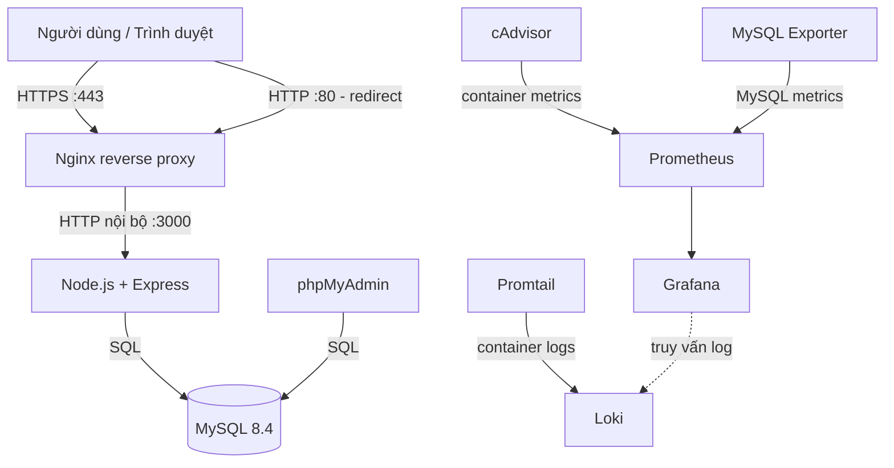

# Quiz System — Hệ thống thi trắc nghiệm trực tuyến

Dự án học phần **Triển khai và Quản trị Hệ thống Phần Mềm**. Quiz System cho phép người dùng đăng ký/đăng nhập, xem và làm bài trắc nghiệm trực tuyến; quản trị viên quản lý tài khoản, vai trò, đề thi và câu hỏi. Ứng dụng được đóng gói bằng Docker Compose, đặt sau Nginx HTTPS và đi kèm bộ giám sát metrics, log để thực hành triển khai và vận hành hệ thống.

Mục tiêu của README là giúp thành viên hiểu **hệ thống dùng để làm gì, luồng hoạt động ra sao, các thành phần liên kết thế nào**, rồi có thể clone repository và chạy môi trường local bằng một lệnh setup.

## 1. Tổng quan chức năng

### Người học (STUDENT)

- Đăng ký tài khoản, đăng nhập và đăng xuất.
- Xem danh sách đề thi công khai và thông tin đề trước khi làm.
- Làm bài theo thời lượng quy định; đề có thể cấu hình trộn câu hỏi và trộn đáp án.
- Nộp bài, xem kết quả và xem lịch sử làm bài.
- Quản lý thông tin tài khoản, đổi mật khẩu và cập nhật email.
- Tạo/quản lý quiz cá nhân khi tài khoản đã có email.
- Sử dụng chức năng quên mật khẩu/đặt lại mật khẩu nếu môi trường đã cấu hình SMTP.

### Quản trị viên (ADMIN)

- Truy cập khu vực quản trị.
- Xem và quản lý tài khoản người dùng, thay đổi vai trò hoặc xóa tài khoản.
- Tạo và quản lý đề thi.
- Quản lý câu hỏi và đáp án của đề.

> Quyền truy cập được kiểm tra ở phía server. Các chức năng thực tế phụ thuộc vào phiên bản mã nguồn hiện có trong repository.

## 2. Luồng hoạt động của hệ thống

### Luồng làm bài trắc nghiệm

1. Người dùng mở ứng dụng qua HTTPS tại Nginx.
2. Người dùng đăng nhập hoặc đăng ký; ứng dụng kiểm tra thông tin và tạo session đăng nhập.
3. Người học chọn một đề thi công khai và xem thông tin đề.
4. Khi bắt đầu, ứng dụng tải câu hỏi và đáp án từ MySQL; tùy cấu hình, câu hỏi/đáp án được xáo trộn.
5. Người học trả lời trong thời gian quy định và nộp bài.
6. Server tính kết quả, lưu lần làm bài vào cơ sở dữ liệu và hiển thị kết quả/lịch sử.

### Luồng quản trị

1. Quản trị viên đăng nhập bằng tài khoản có vai trò `ADMIN`.
2. Ứng dụng kiểm tra quyền trước khi cho phép truy cập khu vực quản trị.
3. Quản trị viên quản lý người dùng, vai trò, đề thi, câu hỏi và đáp án.
4. Dữ liệu được lưu trong MySQL và được ứng dụng đọc lại khi người dùng truy cập.

### Luồng giám sát và logging

1. **cAdvisor** thu thập metrics tài nguyên container.
2. **MySQL Exporter** lấy metrics từ MySQL.
3. **Prometheus** định kỳ scrape metrics từ các target.
4. **Grafana** dùng để truy vấn/hiển thị metrics thành dashboard.
5. **Promtail** đọc log container và gửi log tới **Loki**.
6. Các thành phần giám sát giao tiếp qua Docker network; không phải tất cả đều có cổng public trên máy host.

## 3. Kiến trúc và công nghệ sử dụng

| Thành phần | Công nghệ | Vai trò |
|---|---|---|
| Ứng dụng web | Node.js 22, Express 5 | Xử lý nghiệp vụ, đăng nhập/session, đề thi, chấm điểm và quản trị |
| Giao diện | HTML/CSS và JavaScript được phục vụ bởi Express | Hiển thị trang đăng nhập, danh sách đề, màn hình làm bài, kết quả và quản trị |
| Cơ sở dữ liệu | MySQL 8.4 | Lưu tài khoản, đề thi, câu hỏi, đáp án, lần làm bài và dữ liệu liên quan |
| Truy cập DB | `mysql2` | Kết nối ứng dụng Node.js với MySQL |
| Mật khẩu | `bcryptjs` | Băm mật khẩu trước khi lưu |
| Session | `express-session` | Quản lý trạng thái đăng nhập |
| Email | `nodemailer` | Gửi email đặt lại mật khẩu khi SMTP được cấu hình |
| Reverse proxy / HTTPS | Nginx 1.27 Alpine | Nhận HTTP/HTTPS, chuyển HTTP sang HTTPS và proxy request tới ứng dụng |
| Container | Docker, Docker Compose | Đóng gói, kết nối và khởi chạy các service |
| Metrics | Prometheus, cAdvisor, MySQL Exporter | Thu thập metrics ứng dụng hạ tầng/container và MySQL |
| Dashboard | Grafana | Truy vấn và trực quan hóa metrics |
| Logging | Promtail, Loki | Thu thập và lưu trữ log container để tra cứu |
| Quản lý DB | phpMyAdmin | Giao diện web để xem/quản lý MySQL trong môi trường phát triển |

### Sơ đồ kiến trúc logic



Sơ đồ thể hiện các luồng chính. Cấu hình mạng và cổng cụ thể được định nghĩa trong `docker-compose.yml`.

## 4. Cấu trúc thư mục

```text
TKQTHT/
├── app/
│   ├── Dockerfile             # Build image ứng dụng Node.js
│   ├── package.json           # Dependencies và lệnh chạy app
│   ├── server.js              # Routes, giao diện và nghiệp vụ
│   └── seed_demo.js           # Tạo dữ liệu demo (có xóa dữ liệu cũ)
├── mysql/
│   └── init/
│       ├── 001_schema.sql     # Khởi tạo cấu trúc database
│       └── 002_exporter.sql   # Tạo tài khoản cho MySQL Exporter
├── nginx/
│   ├── nginx.conf             # Reverse proxy và cấu hình HTTPS
│   └── certs/                 # Chứng chỉ local sinh tự động, không commit
├── monitoring/
│   ├── prometheus.yml         # Cấu hình scrape metrics
│   └── .my.cnf.example        # Mẫu thông tin kết nối MySQL Exporter
├── logging/
│   ├── loki-config.yml        # Cấu hình Loki
│   └── promtail-config.yml    # Cấu hình thu thập log
├── scripts/
│   ├── setup-dev.sh           # Chuẩn bị và khởi động môi trường local
│   └── generate-dev-cert.sh   # Tạo chứng chỉ HTTPS tự ký
├── .env.example               # Mẫu biến môi trường
├── docker-compose.yml         # Các service, network, volume và port
└── README.md
```

## 5. Yêu cầu trước khi cài đặt

- Git và Git Bash trên Windows (hoặc Bash trên macOS/Linux).
- Docker Desktop trên Windows/macOS, hoặc Docker Engine và Docker Compose v2 trên Linux.
- Docker Engine phải đang chạy trước khi setup.
- Internet ở lần chạy đầu để tải image và build ứng dụng.
- Các cổng `80`, `443`, `8081`, `9090`, `3000`, `8080`, `3307` chưa bị ứng dụng khác chiếm.

## 6. Clone và khởi động nhanh

Mở Git Bash tại nơi muốn lưu project:

```bash
git clone <URL_REPOSITORY>
cd <TEN_THU_MUC_REPOSITORY>
bash scripts/setup-dev.sh
```

Thay `<URL_REPOSITORY>` bằng URL repository GitHub của nhóm và `<TEN_THU_MUC_REPOSITORY>` bằng thư mục vừa clone.

Script `scripts/setup-dev.sh` được thiết kế để:

1. Kiểm tra Git, Docker, Docker Compose và Docker Engine.
2. Tạo `.env` từ `.env.example` nếu chưa có, không ghi đè file `.env` hiện hữu.
3. Tạo `monitoring/.my.cnf` từ `monitoring/.my.cnf.example` nếu chưa có.
4. Gọi `scripts/generate-dev-cert.sh` để tạo chứng chỉ HTTPS local nếu thiếu cặp file.
5. Kiểm tra cấu hình Compose.
6. Build image và chạy `docker compose up -d --build`.
7. Hiển thị trạng thái container và URL các dịch vụ.

Nếu script báo thiếu file, hãy kiểm tra `scripts/setup-dev.sh`, `scripts/generate-dev-cert.sh`, `.env.example` và `monitoring/.my.cnf.example` đã được commit lên repository chưa.

### Cấu hình `.env`

Khi setup lần đầu, xem lại `.env`. Các giá trị trong `.env.example` là giá trị mẫu; nên thay `MYSQL_ROOT_PASSWORD` và `MYSQL_PASSWORD` bằng giá trị riêng. Nếu sử dụng chức năng email đặt lại mật khẩu, điền các biến `SMTP_*` phù hợp với nhà cung cấp SMTP.

Trong `docker-compose.yml` có giá trị dự phòng cho `SESSION_SECRET`. Để tránh dùng secret mẫu, tạo một chuỗi ngẫu nhiên:

```bash
openssl rand -hex 32
```

Thêm vào `.env`:

```dotenv
SESSION_SECRET=THAY_BANG_CHUOI_NGAU_NHIEN_VUA_TAO
```

Ứng dụng cũng có giá trị dự phòng riêng nếu `SESSION_SECRET` không được truyền vào; vì vậy hãy bảo đảm biến này có mặt trong cấu hình và được chuyển tới container `app`. Không commit `.env` hoặc chia sẻ secret lên GitHub.

## 7. Truy cập dịch vụ

Mở các địa chỉ dưới đây trên máy đang chạy Docker:

| Dịch vụ | URL / cổng | Mục đích |
|---|---|---|
| Quiz System | [https://localhost](https://localhost) | Ứng dụng web qua HTTPS |
| HTTP redirect | [http://localhost](http://localhost) | Chuyển hướng sang HTTPS |
| phpMyAdmin | [http://localhost:8081](http://localhost:8081) | Quản lý MySQL |
| Grafana | [http://localhost:3000](http://localhost:3000) | Dashboard giám sát |
| Prometheus | [http://localhost:9090](http://localhost:9090) | Truy vấn metrics và xem targets |
| cAdvisor | [http://localhost:8080](http://localhost:8080) | Metrics container |
| MySQL từ máy host | `127.0.0.1:3307` | Kết nối bằng công cụ MySQL trên máy host |

Loki và MySQL Exporter không publish cổng trực tiếp ra host; chúng được các service khác gọi qua Docker network. Promtail chạy nền, không có giao diện web riêng.

Các cổng quản trị/MySQL hiện được bind vào `127.0.0.1`, còn Nginx publish cổng `80` và `443`. Không thay đổi bind host thành `0.0.0.0` nếu chưa hiểu rõ rủi ro khi mở dịch vụ ra mạng.

### Lưu ý chứng chỉ HTTPS

Chứng chỉ do `generate-dev-cert.sh` tạo là **chứng chỉ tự ký chỉ dành cho phát triển**. Trình duyệt có thể cảnh báo chứng chỉ không được CA tin cậy. Không dùng cặp chứng chỉ/khóa này cho production và tuyệt đối không commit `nginx/certs/quiz.key` lên Git.

## 8. Kiểm tra và vận hành

Xem trạng thái container:

```bash
docker compose ps
```

Xem service Compose:

```bash
docker compose config --services
```

Kiểm tra cấu hình mà không khởi động container:

```bash
docker compose config --quiet
```

Xem log toàn bộ hệ thống:

```bash
docker compose logs --tail=100
```

Theo dõi log một service:

```bash
docker compose logs -f app
docker compose logs -f db
docker compose logs -f nginx
docker compose logs -f prometheus
docker compose logs -f grafana
docker compose logs -f loki
docker compose logs -f promtail
```

Kiểm tra target Prometheus tại [http://localhost:9090/targets](http://localhost:9090/targets). Các target được cấu hình gồm `prometheus`, `cadvisor` và `mysqld-exporter` (job tên `mysql`); trạng thái `UP` nghĩa là Prometheus scrape được target đó.

## 9. Tạo dữ liệu demo

Chỉ chạy seed trong môi trường demo/phát triển. File `app/seed_demo.js` **TRUNCATE và thay thế dữ liệu hiện có** trong các bảng `attempts`, `answers`, `questions`, `quizzes`, `users`. Sao lưu dữ liệu cần giữ trước khi chạy.

```bash
docker compose exec app node seed_demo.js
```

Nếu container chưa chạy:

```bash
docker compose up -d --build
docker compose exec app node seed_demo.js
```

Dữ liệu seed tạo ra:

- 40 tài khoản: 3 `ADMIN`, 37 `STUDENT`.
- 40 đề quiz.
- 20 câu hỏi cho mỗi quiz, mỗi câu có 4 lựa chọn.

| Vai trò | Tài khoản | Mật khẩu demo |
|---|---|---|
| Admin | `admin1`, `admin2`, `admin3` | `QuizDemo2026!` |
| Student | `student01` đến `student37` | `QuizDemo2026!` |

Tài khoản trên là thông tin demo công khai, không sử dụng trong môi trường thật.

## 10. Dừng, khởi động lại và dọn dữ liệu

Dừng container nhưng giữ lại dữ liệu trong volume:

```bash
docker compose down
```

Khởi động lại:

```bash
docker compose up -d
```

Build lại image và khởi động:

```bash
docker compose up -d --build
```

> **Cảnh báo mất dữ liệu:** lệnh dưới đây xóa cả các volume của project, bao gồm volume MySQL và dữ liệu giám sát. Chỉ dùng khi thực sự muốn reset toàn bộ dữ liệu.

```bash
docker compose down -v
```

## 11. Xử lý lỗi thường gặp

### Docker Engine chưa chạy

Nếu gặp lỗi kết nối `dockerDesktopLinuxEngine` hoặc Docker API, mở Docker Desktop, chờ Engine sẵn sàng rồi kiểm tra:

```bash
docker info
bash scripts/setup-dev.sh
```

### Thiếu chứng chỉ HTTPS

```bash
bash scripts/generate-dev-cert.sh
```

Nếu chỉ còn một trong hai file hoặc muốn tạo lại cặp chứng chỉ:

```bash
bash scripts/generate-dev-cert.sh --force
```

### Cổng bị chiếm

Nếu gặp `port is already allocated` hoặc `bind: address already in use`, đóng ứng dụng đang chiếm cổng hoặc sửa `ports` trong `docker-compose.yml`, rồi cập nhật URL tương ứng trong README.

### MySQL không healthy hoặc đăng nhập thất bại

```bash
docker compose logs --tail=150 db
```

Các file trong `mysql/init` chỉ được MySQL image thực thi tự động khi khởi tạo data directory trống. Thay đổi file SQL hoặc biến môi trường không tự áp dụng vào volume đã khởi tạo. Không xóa volume nếu chưa sao lưu dữ liệu cần giữ.

### MySQL Exporter không kết nối được

Kiểm tra `monitoring/.my.cnf` và đối chiếu với tài khoản được khai báo trong `mysql/init/002_exporter.sql`. Nếu đổi thông tin tài khoản, phải cập nhật đồng bộ. Script setup không ghi đè file `.my.cnf` đã tồn tại.

### Container đang Up nhưng trang không mở được

```bash
docker compose ps
docker compose logs --tail=100 nginx app
```

Kiểm tra cổng, chứng chỉ và log của service liên quan. Trạng thái `Up` không đồng nghĩa mọi chức năng ứng dụng đã được kiểm thử thành công.

## 12. Git và an toàn thông tin

Không commit các file chứa cấu hình riêng/bí mật:

- `.env`
- `monitoring/.my.cnf`
- `nginx/certs/quiz.key`
- `nginx/certs/quiz.crt`

Các file mẫu và script onboarding cần được giữ trong repository:

- `.env.example`
- `monitoring/.my.cnf.example`
- `scripts/setup-dev.sh`
- `scripts/generate-dev-cert.sh`

Trước khi commit:

```bash
git status --short
git diff --check
```

## 13. Checklist dành cho thành viên mới

- [ ] Đã cài Git/Git Bash và Docker Desktop.
- [ ] Docker Engine đang chạy.
- [ ] Đã clone repository mới nhất.
- [ ] Đã chạy `bash scripts/setup-dev.sh` thành công.
- [ ] `docker compose ps` cho thấy các container đã khởi động.
- [ ] Mở được `https://localhost` (có thể hiện cảnh báo do chứng chỉ tự ký).
- [ ] Mở được Grafana, Prometheus và phpMyAdmin.
- [ ] Chỉ chạy seed demo sau khi hiểu rằng dữ liệu cũ sẽ bị thay thế.

## 14. Lệnh nhanh

```bash
# Clone và setup lần đầu
git clone <URL_REPOSITORY>
cd <TEN_THU_MUC_REPOSITORY>
bash scripts/setup-dev.sh

# Kiểm tra / xem log
docker compose ps
docker compose logs --tail=100

# Tạo dữ liệu demo - chỉ dùng cho môi trường demo/test
docker compose exec app node seed_demo.js
```
